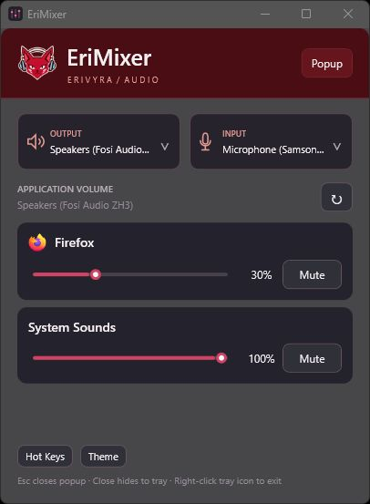

# EriMixer

**A lightweight Windows 11 per-app volume mixer with global hotkeys, audio device selection, compact popup mode, and custom themes.**

  

  

EriMixer brings per-application volume, default audio-device controls, and quick shortcuts into one focused Windows utility. It is freeware: all features are included, with no ads or telemetry. Ko-fi support is optional.

> **Release status:** The v0.3.0 release candidate passed Windows CI, including MSI and portable package checks. Public installer downloads will be linked on the [Releases page](https://github.com/EriVyra/EriMixer-Freeware/releases) when a release is published.

## Why EriMixer

Windows’ built-in mixer is useful for quick level changes. EriMixer adds the controls people often need around it: switch input and output devices, cycle devices with global hotkeys, and keep a compact mixer popup close at hand. Four themes let the window fit a light or dark desktop.

It is designed as a small, direct desktop tool. No account, subscription, feature tiers, advertisements, or telemetry are included.

## Features

- Adjust or mute volume for individual applications
- Choose default input and output devices
- Configure global hotkeys to open the mixer and cycle devices
- Switch between a standard window and a compact popup
- Choose from four colour themes
- Resize the popup and use **Fit apps** to keep active controls visible
- Use the tray icon and optionally start EriMixer with Windows

## Install

1. Open the [Releases page](https://github.com/EriVyra/EriMixer-Freeware/releases) and download the Windows x64 MSI when it is available.
2. Verify the MSI against the SHA-256 value in SHA256SUMS.txt.
3. Open the MSI and follow Windows Installer. The per-user install does not require administrator elevation and supports upgrading v0.2.0.
4. EriMixer requires the **.NET 8 Desktop Runtime (x64)**. It is not bundled with the installer.
5. To uninstall, use **Settings → Apps → Installed apps → EriMixer → Uninstall**. Your settings remain in %LOCALAPPDATA%\EriMixer.

The MSI and app are unsigned. Windows may show a SmartScreen or unknown-publisher warning. Check the SHA-256 hash and continue only if you trust the official EriMixer release source.

## Portable version

Download EriMixer-0.3.0-portable-x64.zip from Releases, verify its checksum, extract it to a writable folder, then run EriMixer.exe. Portable mode does not create an uninstall entry. Exit the tray copy before switching between portable and installed copies.

## Compatibility and verification

EriMixer is built for Windows 11 x64. Eri has verified MSI installation and upgrade, themes, hotkeys, output-device cycling, and uninstall. The portable build also opens successfully. Input-device cycling still needs testing with at least two microphones; with one active microphone, cycling cannot demonstrate a change. Startup and tray behavior still need end-user checks.

## Support

EriMixer is free to use with no purchase requirement. If you find it useful, you can optionally [support EriVyra on Ko-fi](https://ko-fi.com/erivyra).

## Build from source

The project targets .NET 8 WPF. Windows CI builds and validates the application, per-user x64 MSI, portable ZIP, and SHA-256 checksums. See [release notes](RELEASE_NOTES_v0.3.0.md) and the [release-candidate QA checklist](RELEASE_CANDIDATE_QA.md).
